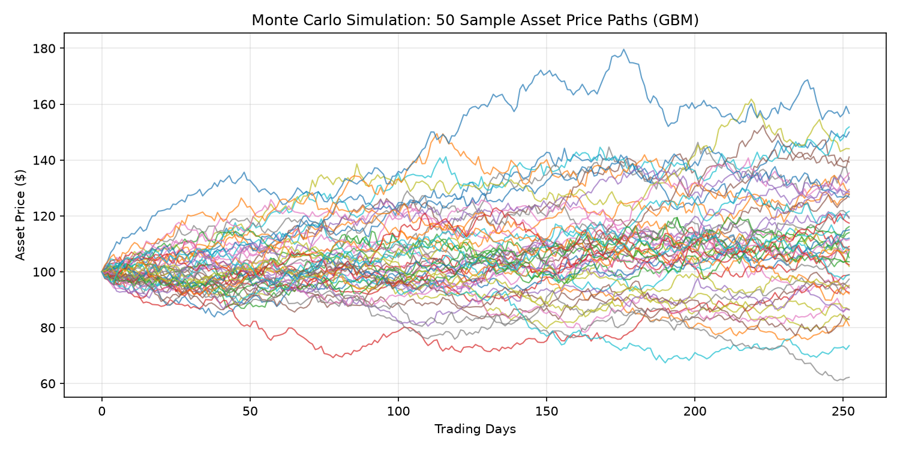
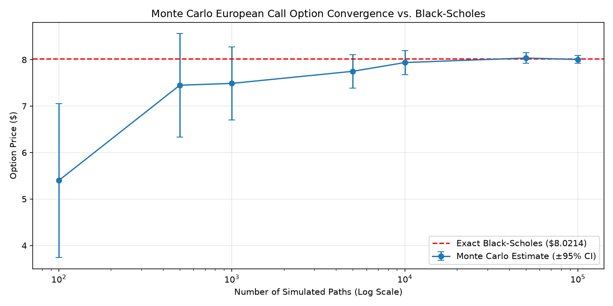

# Monte Carlo Market & Option Pricing Simulator

A quantitative simulation engine built in Python to model stochastic asset price trajectories using **Geometric Brownian Motion (GBM)** and price **European Call Options** via risk-neutral Monte Carlo integration benchmarked against the analytical **Black-Scholes-Merton** model.

---

## 1. Geometric Brownian Motion (GBM) Asset Path Simulator
Simulates $N = 10,000$ daily asset price trajectories over a 1-year horizon ($252$ trading days) under log-normal returns:

$$S_{t + \Delta t} = S_t \cdot \exp\left( \left(\mu - \frac{1}{2}\sigma^2\right)\Delta t + \sigma \sqrt{\Delta t} \, Z \right), \quad Z \sim \mathcal{N}(0, 1)$$

* **Parameters:** $S_0 = \$100$, $\mu = 8\%$, $\sigma = 20\%$, $T = 1.0\text{ yr}$
* **Results ($10,000$ paths):** Mean Final Price = $\$108.16$ | Median = $\$106.12$ | 5th–95th Percentile = $[\$76.42, \$147.06]$



---

## 2. European Call Option Pricing & Convergence Analysis
Computes risk-neutral discounted expected payoffs $C_{\text{MC}} = e^{-rT} \mathbb{E}[\max(S_T - K, 0)]$ across increasing sample sizes ($N = 100$ to $100,000$) and verifies $O(1/\sqrt{N})$ error decay against the exact Black-Scholes closed-form price ($S_0 = \$100, K = \$105, r = 5\%, \sigma = 20\%, T = 1.0$).



---

## Tech Stack & How to Run
* **Languages & Libraries:** Python 3, NumPy, Matplotlib
* **Run simulations locally:**
  ```bash
  pip install numpy matplotlib
  python gbm_simulator.py
  python option_pricer.py
 ```